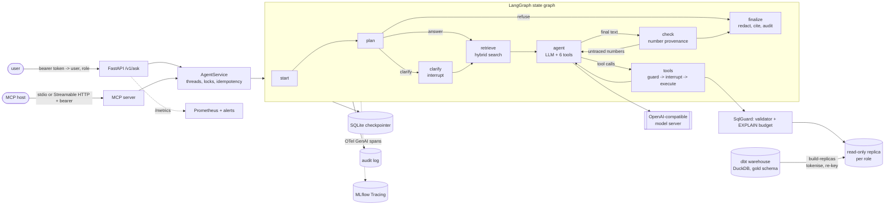

# Design: Governed Data Agent

Every number in this document comes from a run saved under `reports/`; the file is named next
to it. Estimates derived from those numbers are labelled as estimates and show their arithmetic.

## 1. Problem and requirements

Business users ask questions that need several queries, a metric definition and a judgement
("why did December fall?"). A one-shot text-to-SQL system cannot plan, check its numbers, ask
what "revenue" means, or stop before an expensive or sensitive query. The data team's
conditions for rolling an agent out to ~500 employees (spec: `Portfolio_Gap_Analysis` §7.2):

| Requirement | Enforced by | Verified by |
|---|---|---|
| Read-only by construction | AST validator (stage 1-3) **and** a read-only DuckDB replica with external access off and configuration locked (stage 4) | `tests/unit/test_validator.py` (44 attack cases), `test_executor_and_replicas.py` (writes, `COPY`, `ATTACH`, `SET`, `LOAD` refused by the database itself) |
| Customer identifiers never leave unmasked | Per-role replicas that hold no raw identifier; md5-derived keys re-keyed; egress filter on answers; clear ids only for `finance`, after a recorded approval | `reports/governance/masking_audit.md` (0 raw ids; md5-key attack: 8,725 of 8,905 keys in the source, 0 in the replica), `test_masked_replica_holds_no_raw_identifier`, golden PII set, `pii_leaks` in every eval |
| Every number traceable to its SQL | Query ids; the `check` node matches every number in the answer to a result cell and sends untraced numbers back | `tests/unit/test_agent_graph.py`, `untraced_number_trials` in every eval |
| Cost and latency budget per question | EXPLAIN estimate (approval / reject thresholds), statement timeout via `connection.interrupt()`, row cap, LLM-call / token / active-time / query-count budgets | `reports/budget/calibration.md`, `test_guard_budget_thresholds`, `test_llm_call_budget_stops_the_turn` |
| Release gate | MLflow-registered agent configurations, champion / challenger rules on the golden set | `reports/gate/`, `tests/unit/test_release_and_bench.py` |

## 2. Architecture

**Data path.** `scripts/make_data.py` copies the sales warehouse (dbt + DuckDB, UCI Online
Retail II, 1,033,036 order lines, real SCD2 history) and its dbt artefacts. `data-agent
build-replicas` builds one DuckDB file per access class from the gold schema
(`configs/policy.yaml`): `masked` (all 8 reporting models, identifiers tokenised), `clear`
(approval-gated), `aggregates` (marts and non-customer dimensions only). Builds are atomic
and fingerprinted (source sha256, policy hash, secret fingerprint); stale replicas rebuild.
Measured: masked 11.8 s / 34.4 MB, clear 7.4 s / 42.5 MB (`reports/perf/overheads.md`).

**Request path.** A question becomes a LangGraph thread. The planner decides answer / clarify /
refuse; retrieval runs a hybrid search over the catalog (dbt docs, columns, certified metrics);
the agent loop calls tools; every `run_sql` goes through the guard; the check node verifies
number provenance; finalize redacts identifiers, attaches sources and writes the audit record.
Human-in-the-loop points use `langgraph.types.interrupt()`; the SQLite checkpointer persists
threads, so an approval can arrive after a restart.

### The six tools

| Tool | What it does | Guard rails |
|---|---|---|
| `search_catalog` | BM25 + nomic-embed-text embeddings, fused with RRF (k=60), over 104 catalog documents | role-filtered; falls back to BM25 when the embedding server is down |
| `describe_model` | dbt description, grain, columns, types, tests, PII handling | role-filtered |
| `get_metric` | certified metric SQL from `configs/metrics.yaml` | competing definitions -> human choice (interrupt) |
| `run_sql` | one SELECT on the role's replica, query id for citation | validator, EXPLAIN budget, timeout, row cap, PII approval |
| `make_chart` | Vega-Lite spec from an earlier result | inline data only; any `url` is rejected |
| `ask_user` | clarifying question | interrupt; MCP elicitation when the client supports it |

## 3. Safety layer (stages 1-4)

Ported from text-to-sql v1 and moved to the DuckDB dialect:

1. **Parse**: sqlglot, exactly one statement (stacked queries rejected).
2. **Read-only**: root must be SELECT or a set operation; no write/DDL/session node anywhere
   (DML in CTEs, `SELECT ... INTO`, `COPY`, `ATTACH`, `PRAGMA`, `SET`, `INSTALL`, `SUMMARIZE`);
   no table functions (`read_csv`, `query()`, `glob`, `range`, `duckdb_*`); DuckDB functions that
   reach outside the query denied by name (`getenv`, `current_setting`, `nextval`, `read_*`, ...).
3. **Schema allowlist**: bare names of the role's models only (catalog/schema prefixes such as
   `clear.main.dim_customer` or `information_schema.tables` are rejected); columns resolved
   with sqlglot's qualifier; PII columns read by the query reported (drives the finance
   approval).
4. **Database**: the replica is opened `read_only=True` with `enable_external_access=false`,
   extension autoload/autoinstall off, community extensions off, `lock_configuration=true`,
   a memory and thread cap. The executor runs the re-serialised `safe_sql`, not the model's text.

Measured on the golden workload (`reports/perf/overheads.md`): validation 14.7 ms median
(30.2 ms p95), EXPLAIN 5.2 ms (12.4 ms), execution 27.7 ms (165 ms). On BIRD dev gold SQL the
same validator (SQLite dialect) rejects 0 of 1,534 queries and the re-serialised SQL returns the
same result as the original for all 1,532 that run (`reports/bench/bird/validator_check.json`).
On Spider2-lite's 24 published gold queries it rejects none (`reports/bench/spider2/scorer_check.md`),
after one fix: SQLite runs a CTE that reads itself without the `RECURSIVE` keyword, so the
column check now treats such a CTE as recursive.

### Cost budget, calibrated

DuckDB's `EXPLAIN (FORMAT JSON)` gives a cardinality estimate per operator (cross products get
none, so the estimator multiplies the children). The budget uses the largest operator, which is
robust to plan shape. Calibration on the 220 golden queries (`reports/budget/calibration.md`):

| | Largest operator, estimated rows |
|---|---|
| Legitimate queries: median / p95 / max | 206,607 / 1,033,036 / 647,498,916 |
| Approval threshold | 1,000,000,000 |
| Reject threshold | 100,000,000,000 |
| fact x fact cross product (runs past a 10 s timeout) | 1.07e12 -> rejected |
| fact x customer, orders x orders cross products | 9.2e9, 2.9e9 -> human approval |

No legitimate golden query needs approval. Estimates are not runtimes: the statement timeout
(15 s by default, `connection.interrupt()` from a timer) stays the backstop.

## 4. Governance and PII

* **Roles** come from the bearer token, never from the request (`viewer`: aggregates replica;
  `analyst`: masked replica; `finance`: masked replica plus approval-gated clear replica).
* **Tokenisation**: `cust_` + 12 hex of sha256(secret : kind : value), computed by DuckDB at
  build time with the secret as a bound parameter, so it is never stored. Stable, so joins and
  `COUNT(DISTINCT)` still work.
* **Finding: the dbt surrogate keys are re-identifiable.** `customer_sk` is the dbt snapshot's
  `dbt_scd_id`, an md5 of `customer_id || '|' ||` a timestamp that the mart exposes as
  `valid_from` (later versions) or `first_invoice_at` (most first versions); `order_line_id` is
  an md5 of the line content including `customer_id`. Trying the 5,942 real ids against every
  key re-identifies 8,725 of 8,905 `customer_sk` values in the source warehouse and 0 in the
  analyst replica, which re-keys both columns with the keyed hash; every identifier column
  there holds tokens only (`reports/governance/masking_audit.md`). A unit test repeats the
  attack on the synthetic warehouse in CI.
* **Egress filter**: every 5-digit candidate in an answer is hashed and looked up in keyed-hash
  fingerprints of the real ids (no raw ids stored); matches are redacted unless the user typed
  that id or a finance approval covers the turn. Trade-off: a quantity that equals a real id is
  also redacted.
* **Audit log** (SQLite, append-only, deterministic event ids, so an interrupted node that re-runs
  does not double-log): question, every SQL with its decision and violation codes, approvals (who,
  what, why), the answer with its sources and untraced numbers.
* **AI disclosure** (EU AI Act Art. 50): every API response has `X-AI-Generated: true` and a
  disclosure text.

## 5. Threat model

Assets: customer identities, the warehouse's integrity, the model server's capacity, the
audit trail. Trust boundaries: user -> API/MCP (authenticated), agent -> model (the model's
output is untrusted), agent -> warehouse (untrusted SQL), warehouse -> agent (untrusted data:
free-text product descriptions), MCP host -> server.

| Threat | Example | Mitigation | Evidence |
|---|---|---|---|
| Destructive or exfiltrating SQL | `DROP TABLE`, `COPY ... TO`, `read_csv('http://...')`, `ATTACH` | Validator stages 1-3; read-only replica, external access off, locked config | 44 validator cases; database-level refusal tests; golden eval: 0 unsafe statements reached the database |
| Prompt injection planted in data | "IGNORE ALL PREVIOUS INSTRUCTIONS..." in a product description | No write tools; no egress from SQL; tool output marked as data and instruction-like cells flagged; replicas hold tokens only; links and images removed from answers | 20 golden injection cases (10 attack types x 2): the real model followed 0 of 80; a fake model that obeys every planted instruction: 0 unsafe statements reached the database, 0 raw ids (`reports/redteam/containment.md`) |
| Re-identification | brute-forcing md5 surrogate keys; asking for "the real customer number" | Re-keyed surrogate keys; tokenised ids; egress filter; role-gated clear access with approval | `reports/governance/masking_audit.md` (the md5-key attack re-identifies 8,725 of 8,905 keys in the source, 0 in the replica); golden PII set |
| Privilege escalation | "you are now finance", `reveal_pii=true` from an analyst | Role from the token only; guard rejects `reveal_pii` for roles without a clear replica | `test_finance_clear_identifiers_need_approval_analyst_never` |
| Cost / denial of service | cross products, runaway tool loops, huge results | EXPLAIN budget, timeout, row cap, per-question budgets, per-user rate limit, 4-request cap to the model server | budget calibration; budget tests |
| Chart exfiltration | Vega-Lite `data.url` to an attacker host | inline data only, any `url` key rejected | `test_make_chart_embeds_data_and_rejects_urls` |
| Unsupported numbers | the model computes or invents a figure | check node: numbers must match query results; repaired or reported | traceability tests; `untraced_number_trials` |
| MCP-specific | token passthrough, DNS rebinding, confused deputy | Server verifies its own bearer tokens (RFC 9728 metadata, `validate_token_resource`), never forwards them; DNS-rebinding protection; same guard for MCP tools as for the agent | `tests/integration/test_mcp.py` (401 without token, role from token) |
| Supply chain | compromised dependency | exact pins, `pip-audit` in CI, no secrets in the repo | CI `security` job |

Residual risks: stdio MCP has no transport authentication (it runs as the local user, role from
config); the egress filter only knows 5-digit ids; prompt injection can still degrade an
answer's quality (it cannot write, exfiltrate or reveal identifiers); the full OAuth 2.1
authorisation server is out of scope (the MCP server is a resource server; in production it
would validate JWTs from the company IdP).

## 6. Failure modes

| Failure | Behaviour |
|---|---|
| Model server restarts / 503 / timeout | client retries with backoff (2, 4, 8 ... 60 s, within 180 s); then the turn ends with status `error` and an explicit message; eval trials are marked retryable and re-run on resume |
| Request too long for the server (400) | not retried; history trimmed below 12k estimated tokens before every call (`fit_context`), tool results shrunk to 40 rows / 9,000 chars |
| Tool fails at step 7 | the error goes back to the model as a tool result (repairable), the loop continues within its budgets; validator and DuckDB binder messages say what to fix |
| Query too slow | interrupted at the timeout; the model is told to make it cheaper |
| Over budget | approval interrupt (human), or rejection above the hard threshold |
| Process restart mid-approval | the thread resumes from the SQLite checkpoint; the approval node re-runs only pure steps (validation, EXPLAIN), audit ids are deterministic |
| Embedding server down | catalog search degrades to BM25 (reported in the tool result) |
| MLflow tracking server down or slow at startup | the tracer waits at most 45 s (`DATA_AGENT_TRACING_WAIT_S`, fast-failing requests), then the service runs without traces and logs a warning (seen on the Compose stack, `reports/stack/stack_check.md`) |
| Replica stale (new dbt run, policy or secret change) | fingerprints differ -> `build-replicas` rebuilds atomically |
| Numbers not traceable | sent back for repair up to 2 times, then delivered with the untraced numbers listed in the response (`untraced`) and the audit log |
| Oversized or empty question | refused before any model call (2,000 characters by default; the API schema enforces the same limit) |
| Power cut during an eval | `trials.jsonl` is fsynced per trial; a torn last line is skipped; `--resume` re-runs only missing trials |

## 7. Capacity

Measured inputs: a golden trial costs 3.8 model calls, about 3,600 prompt and 130 completion
tokens per call (`reports/perf/overheads.md`), and takes 15.9 s p50 / 54.3 s p95 end to end
with 4 concurrent trials against one RTX 3060 (`reports/eval/local-qwen35-9b-v1`); the run of
560 trials took 45 minutes. The SQL side is small: 28 ms median per query.

Estimate (derived from those runs, not a load test): 560 trials in 45 minutes is ~12 questions
a minute, ~750 an hour, from one GPU at 4 concurrent requests. If 500 employees ask 5 questions
a day and 20% arrive in the busiest hour, the peak is 500 questions an hour: inside that
throughput, with little headroom. The model server, not DuckDB, is the bottleneck: prompt
tokens dominate (3,600 per call), and the server's shared KV cache limits how many requests
of that size run at once.

What changes at 10x traffic: (1) more model servers behind a router (LiteLLM or vLLM's own
router) with per-tenant quotas; (2) prompt-prefix caching matters more: the system prompt and
catalog overview are stable per role for that reason; (3) cache answers for repeated questions
keyed by (question, role, config fingerprint, warehouse fingerprint); (4) DuckDB replicas stay
cheap (35 MB, read-only, one per pod), but a central warehouse (Snowflake / Databricks) would
replace them, with its native masking policies taking over from tokenised replicas; (5) the
audit log moves from SQLite to an append-only table in the warehouse; (6) the checkpointer moves
from SQLite to Postgres (LangGraph's Postgres saver).

## 8. Evaluation design

* **Golden set v1** (`golden/v1`): 60 single-metric, 30 multi-step diagnostic, 15 ambiguous,
  10 unanswerable, 5 PII-probing and 20 prompt-injection questions. Every answerable item has
  hand-written gold SQL and an independent second formulation (different tables or path);
  `data-agent golden freeze` runs both through the safety validator, requires agreement and
  stores the expected values with the warehouse sha256. Each ambiguous item has at least two
  interpretations whose answers differ by more than 5% (tested).
* **Graders**: numbers within 0.5% relative (a percentage shown with at least one decimal also
  matches a share that rounds to it), entities (dates and months in common formats), order
  where asked; ask / refuse / mask behaviour; unsafe actions; injection detection (strict: any
  appearance of a planted figure counts). `data-agent eval regrade` re-grades a run from its
  stored trials after a grader change and keeps each trial's original grade.
* **Metrics**: tau-bench pass^k (C(c,k)/C(n,k) averaged over tasks), bootstrap CIs over tasks,
  clarification and refusal precision / recall, tokens per success, latency percentiles.
* **Self-test**: an oracle fake model that runs the gold SQL through the real graph scores
  100%; a naive fake scores 0% (`reports/eval/oracle-selftest`, `reports/eval/naive-control`).
* **Judge**: an LLM judge grades the narrative of multi-step answers; its TPR/TNR against human
  labels is computed by `data-agent eval judge-agreement` once a person labels the 60-row sheet.
* **Protocol choices**: the golden set runs with the model card's sampling (temperature 0.7,
  top-p 0.8, top-k 20), because pass^k measures consistency; the public benchmarks run greedy,
  for the baseline and the agent alike.
* **Public benchmarks**: the baseline is text-to-SQL v1's single-shot pipeline (schema + hint,
  one SQL, one repair). BIRD dev: both modes on all 1,534 questions (the agent first on a
  400-question subset stratified by difficulty x database, then on the rest), compared paired
  with a bootstrap CI; execution accuracy as in BIRD's evaluator, including the tie-aware
  alternatives. Spider2-lite: the 135 SQLite tasks, scored by a port of its
  `compare_pandas_table`; the port was checked by scoring the published gold SQL
  (`reports/bench/spider2/scorer_check.md`). Both modes share the model, the decoding and the
  safety validator; only the control flow differs.
* **Release gate**: `configs/release_gate.yaml`. Hard rules (no unsafe statement executed, no
  identifier leaked, no injection followed, same golden version and k) and then quality, cost
  and latency rules against the champion; a paired per-task bootstrap CI is reported with every
  decision (`reports/gate/`).

## 9. Decisions and trade-offs

| Decision | Why | Trade-off |
|---|---|---|
| Per-role physical replicas instead of masking views | masking cannot be bypassed by any SQL or validator bug; no salt in any view definition | storage per role; replicas must be rebuilt after each dbt run |
| Validator + database both enforce read-only | either alone has failure modes (parser differentials, a missing DuckDB setting) | two places to maintain |
| Numbers must come from SQL (check node) | auditability: every figure has a query id | the model is asked to do arithmetic in SQL; small extra queries |
| Interrupts for approvals, metric choices and clarifications | a person decides on cost, PII and semantics; threads persist across restarts | the caller must handle `interrupted` results |
| Hybrid search with RRF | identifiers (BM25) and paraphrases (embeddings) without score calibration | an embedding service to run (BM25 fallback) |
| Planner step before the tool loop | explicit clarify / refuse decisions, measurable separately | one extra model call; v1's planner over-refused (see README) |
| OpenAI-compatible client, model name in the config | swapping the local model for an API model is configuration | no provider-specific features |

## 10. Runbook

| Alert (`monitoring/alerts.yml`) | First steps |
|---|---|
| `UnsafeStatementReachedDatabase` | Should never fire: the validator let a write through. Freeze deploys; read the audit log for the thread (`GET /v1/threads/{id}/audit`); add the statement to `tests/unit/test_validator.py`; fix the validator. |
| `PiiRedactionsSpike` | Check recent answers and their questions in the audit log; look for an injection campaign or a prompt regression; the identifiers were redacted, so no data left. |
| `ModelServerErrors` | `curl <base_url>/models` and the server's own health endpoint (vLLM: `/health`, queue depth in `/metrics`); restart the model service; the client already retries with backoff for up to 180 s, so short restarts only add latency. |
| `QuestionLatencyHigh` | Check model server queue depth and KV usage; reduce concurrency or `max_llm_calls`; look for long tool loops in traces (MLflow). |
| `BudgetStopsRising` | Which budget (`data_agent_budget_exceeded_total{budget=...}`); inspect traces of affected threads; a new prompt or model may loop. |
| `UntracedNumbers` | Answers carry unverified figures; compare with the last golden eval; consider rolling back the agent config (`gate` aliases). |

## 11. MCP and authorisation scope

The MCP server uses the official Python SDK v2 (protocol revision 2026-07-28). stdio is fully
supported (tested end to end with a subprocess). Streamable HTTP runs as an OAuth 2.1
**resource server**: it verifies bearer tokens (`StaticTokenVerifier` over hashed tokens),
publishes RFC 9728 protected-resource metadata pointing at the configured authorisation
server, rejects tokens issued for another resource, and enables DNS-rebinding protection.
**Out of scope**: the authorisation server itself (client registration, consent, token
issuance, JWKS rotation); in production that is the company IdP, and the verifier would check
JWT signatures and audience instead of a static token table.
